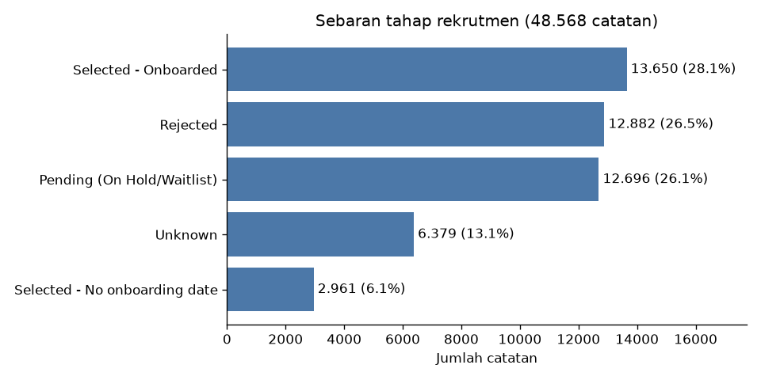
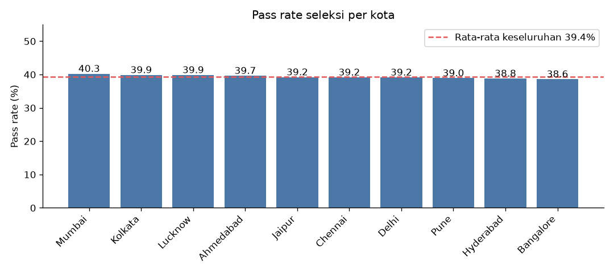
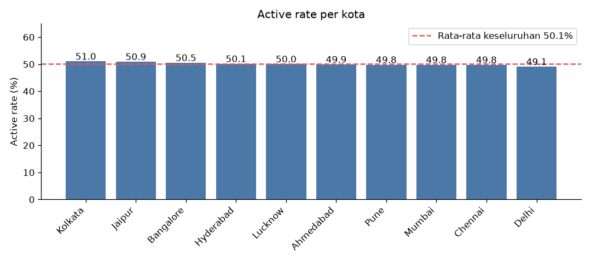
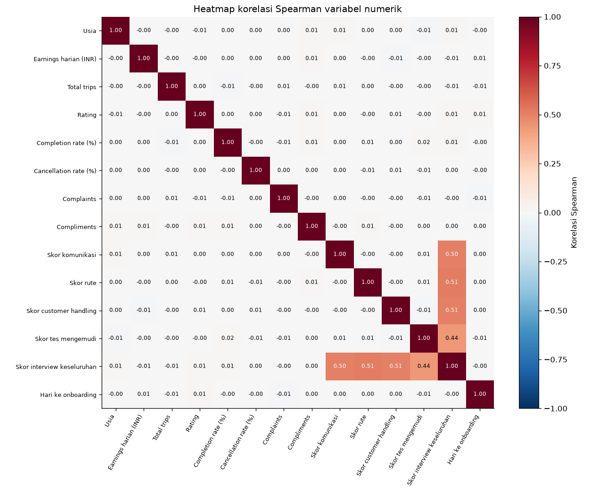
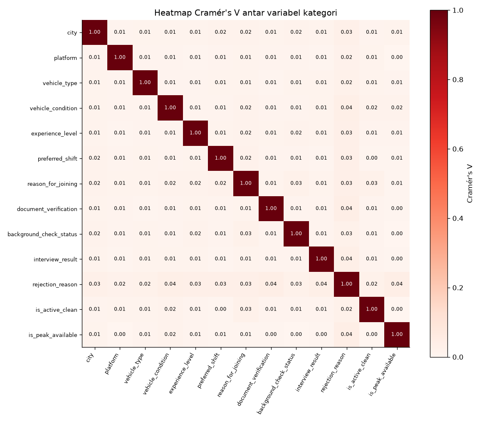
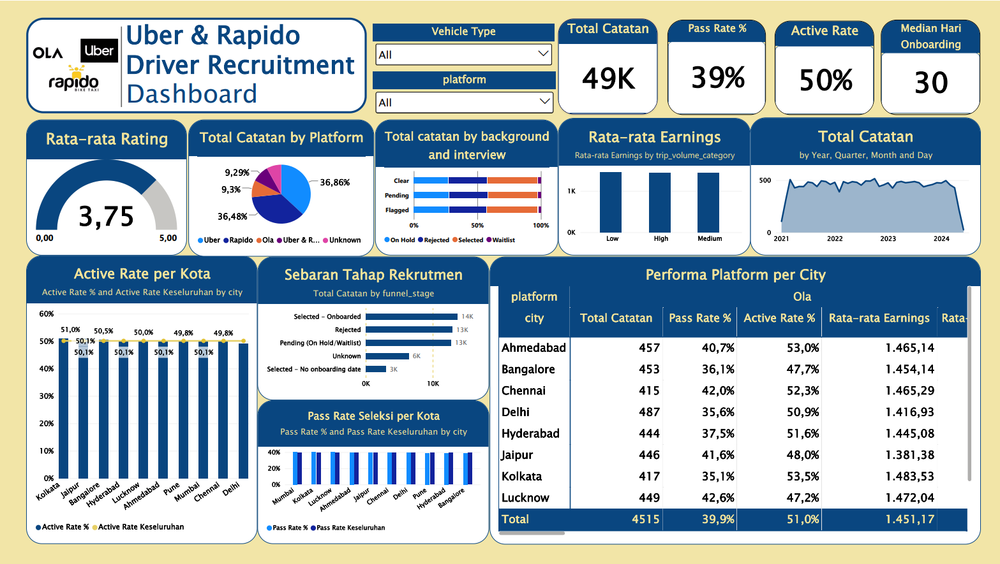

# Analisis Rekrutmen Driver Uber & Rapido (India)

Proyek portofolio BI: membersihkan dataset driver yang sengaja dibuat kotor, memuatnya ke PostgreSQL, menghitung KPI rekrutmen dengan SQL, lalu menguji apakah ada perbedaan antar kota, platform, dan jenis kendaraan.

> **Catatan:** dataset ini sintetis (dibangkitkan untuk latihan data cleaning). Temuan di bawah menggambarkan data ini, bukan kondisi Uber atau Rapido sebenarnya.

## Pertanyaan bisnis

1. Berapa persen catatan rekrutmen yang lolos seleksi, dan bagaimana sebaran status rekrutmennya?
2. Apakah kota, platform, atau jenis kendaraan memengaruhi hasil seleksi dan active rate?
3. Apakah skor interview memprediksi kualitas driver (rating, cancellation rate, complaints)?
4. Apakah driver yang produktif juga berkualitas?
5. Berapa lama dari interview sampai onboarding?

## Dataset

- Sumber: [Kaggle - Uber & Rapido Driver Dataset India (Dirty)](https://www.kaggle.com/datasets/abhaypanchal/uber-and-rapido-driver-dataset-india-dirty)
- 50.000 baris dan 33 kolom. Data mentah tidak disertakan di repo; unduh dari Kaggle dan simpan sebagai `uber_rapido_driver_dirty.csv`.
- Hasil akhir: `drivers_clean.csv` (48.568 baris, 46 kolom).

## Alur kerja

| Tahap | Alat | Hasil |
|---|---|---|
| Business understanding | Dokumen | Pertanyaan bisnis dan KPI |
| Data understanding dan cleaning | Python (pandas) | `drivers_clean.csv`, [cleaning log](docs/cleaning_log.md) |
| Analisis KPI | PostgreSQL, pgAdmin | `sql/01` sampai `sql/03` |
| EDA dan uji statistik | Python (scipy, matplotlib) | `04_drivers_EDA_visualization.ipynb`, `docs/img/` |
| Dashboard | Power BI | `dashboard/uber_rapido_dashboard.pbix`|

## Temuan utama

**1. Sebaran status rekrutmen (48.568 catatan)**

- Selected 34,2%, Rejected 26,5%, On Hold 23,6%, Waitlist 2,5%, hasil kosong 13,1%.
- Pass rate seleksi 39,4% (16.611 Selected dari 42.189 catatan yang punya hasil).
- Median waktu dari interview ke onboarding 30 hari, tersebar rata dari 1 sampai 60 hari (n = 12.163).

**2. Tidak ada segmen yang menonjol**

| Perbandingan | Uji | p-value |
|---|---|---|
| Pass rate vs kota | Chi-square | 0,877 |
| Pass rate vs platform | Chi-square | 0,453 |
| Pass rate vs jenis kendaraan | Chi-square | 0,110 |
| Active rate vs kota | Chi-square | 0,743 |
| Earnings vs platform | Kruskal-Wallis | 0,548 |
| Trips vs platform | Kruskal-Wallis | 0,593 |
| Rating vs platform | Kruskal-Wallis | 0,552 |

Tidak ada perbedaan signifikan. Kekuatan keterkaitan antar kolom kategori (Cramér's V) hanya 0,008 sampai 0,014, jauh di bawah batas 0,1.

**3. Skor interview tidak memprediksi kualitas driver**

Korelasi Spearman antara skor interview dan rating, cancellation rate, serta complaints hanya 0,00 sampai 0,01. Skor interview keseluruhan berkorelasi 0,44 sampai 0,51 dengan empat skor komponennya karena diduga merupakan rata-rata keempat skor tersebut, bukan informasi tambahan.

**4. Status aktif tidak terkait seleksi**

Active rate sekitar 50% di semua tahap rekrutmen, termasuk driver yang ditolak (chi-square = 6,12; p = 0,19). Karena itu status aktif dianalisis terpisah dari funnel.

**5. Temuan kualitas data**

- `driver_id` tidak unik: 2.651 baris berbagi 1.302 ID, hampir semuanya orang berbeda.
- 17,8% driver Selected tidak punya tanggal onboarding, dan 7,1% driver Rejected justru punya.
- Verifikasi dokumen dan background check tidak berkaitan dengan hasil interview (V = 0,01).

## Dashboard

Dashboard satu halaman di Power BI (`dashboard/uber_rapido_dashboard.pbix`) menampilkan KPI utama, sebaran tahap rekrutmen, pass rate dan active rate per kota, tren onboarding bulanan, serta komposisi platform, dengan filter platform dan jenis kendaraan. Sumber data: tabel `drivers` di PostgreSQL.

## Rekomendasi (contoh cara berpikir)

1. Jangan menentukan prioritas rekrutmen berdasarkan kota, platform, atau jenis kendaraan: data tidak menunjukkan perbedaan.
2. Wajibkan pengisian hasil interview dan tanggal onboarding, dan tetapkan batas waktu keputusan untuk status On Hold dan Waitlist (26,1% catatan menggantung).
3. Terbitkan ID driver yang unik supaya driver bisa dilacak.
4. Tinjau apakah hasil verifikasi dokumen dan background check benar-benar menjadi syarat seleksi.

## Ringkasan cleaning

50.000 baris menjadi 48.568 (951 duplikat identik dan 481 duplikat setelah teks distandarkan dibuang). Placeholder tersembunyi (`na`, `unknown`, `unrated`) diubah menjadi kosong, nilai mustahil (usia 999 atau negatif, `99999`, rate di atas 100) dibersihkan, dan lima belas kolom turunan ditambahkan. Detail per kolom ada di [docs/cleaning_log.md](docs/cleaning_log.md).

## Struktur repo

- `sql/`: skrip pembuat tabel, validasi, dan query KPI
- `docs/`: cleaning log, tabel hasil uji, dan gambar
- `04_drivers_EDA_visualization.ipynb`: EDA dan uji statistik
- `drivers_clean.csv`: data bersih
- Notebook cleaning (`02_drivers_cleaning.ipynb`) menyusul
- `dashboard/`: dashboard Power BI (`uber_rapido_dashboard.pbix`)

## Cara menjalankan

1. Buat database PostgreSQL dan jalankan `sql/01_create_table.sql`.
2. Muat `drivers_clean.csv` ke tabel `drivers` dengan perintah `\copy` di psql. Daftar kolom pada perintah harus mengikuti urutan header CSV.
3. Jalankan `sql/02_validation.sql`, lalu `sql/03_kpi_queries.sql`.
4. Buka `04_drivers_EDA_visualization.ipynb` (membutuhkan pandas, scipy, dan matplotlib).
5. Buka 'dashboard/uber_rapido_dashboard.pbix' di Power BI Desktop Sumber datanya tabel `drivers` di PostgreSQL lokal, jadi ubah koneksi di *Transform data*, *Data source settings* jika nama server atau database berbeda.

## Keterbatasan

- Data sintetis dengan pola serba seragam dan hampir tanpa korelasi, jadi tidak dapat digeneralisasi.
- Platform Ola (9,3% baris) berada di luar cakupan Uber dan Rapido, tetapi dipertahankan sebagai kategori tersendiri.
- Tanggal bulan-saja (2.657 baris) ditandai dan tidak dipakai untuk menghitung lama onboarding.
- Status rekrutmen saling lepas, bukan corong bertahap; "Selected tanpa tanggal onboarding" tidak sama dengan "belum onboarding".
- Duplikat dengan salah ketik nama tidak ditelusuri.
